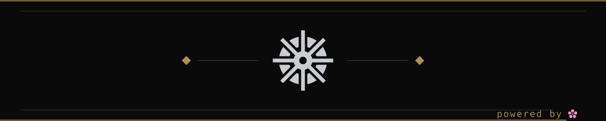

  

<h1 align="center">Rudolf Cantabria</h1>

  herramientas que se instalan y se quedan · Chile

Escribo herramientas para gente que trabaja: técnicos en terreno, radioaficionados,
emprendedores que compiten con lo que tienen a mano. Sin demos que no aguantan un
martes. Lo que hay acá corre en tu máquina, con tus datos, sin pedirle permiso a nadie.

## Lo que hay

| Proyecto | Qué resuelve |
| --- | --- |
| **[guksys](https://github.com/cantabriarudolf/guksys)** | antiX con identidad propia: branding y defaults desacoplados del upstream, con rollback en cada cambio. |
| **[CotizaPro](https://github.com/cantabriarudolf/CotizaPro)** | Cotización, rentabilidad, caja y compras para servicios técnicos. SQLite local: tus números no salen de tu máquina. |
| **[STOKE](https://github.com/cantabriarudolf/stoke)** | Arnés táctico de agentes. Construir. Adaptar. Defender. |
| **[scrapysound](https://github.com/cantabriarudolf/scrapysound)** | De un video largo a los catorce segundos que importan: audio, subtítulos y clips por timestamp. |
| **[gentle-emote-arcade](https://github.com/cantabriarudolf/gentle-emote-arcade)** | El avatar del agente, contado con sprites y sonidos de videojuegos. |
| **[base-rf](https://github.com/cantabriarudolf/base-rf)** | Manual de campo para ingenieros en telecomunicaciones, con QSO CERO: un juego de Morse que abre desde `file://`. |
| **[Compass](https://github.com/cantabriarudolf/Compass)** | Gestión administrativa y financiera: cada regla de datos con dueño, writer y test documentados. |

## Cómo trabajo

Tres cosas que no negocio: los datos se quedan donde corresponde, cada cambio deja
vuelta atrás, y lo que no tiene test no está terminado. El resto es oficio.

Si algo te sirve para lo tuyo, se usa. Si te sirve para tu negocio, se conversa.

---

  <strong>motor · Gentle Shell</strong> · Chile

